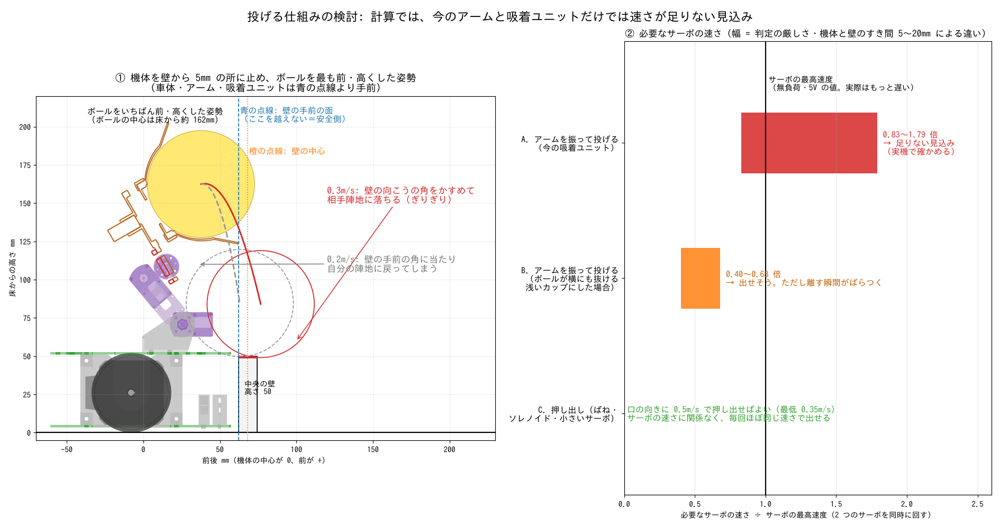

# 投げる仕組みの検討（Issue #11）

検討日: 2026-11-13

## 結論

- 計算では、**今のアームと吸着ユニットのまま振って投げると、速さが足りない見込み**。
  - サーボ 2 つを同時に回して、最高速度の 0.83〜1.79 倍が必要になる。
  - ただし、サーボの速さは他サイトの値（無負荷・5V）で、ボールが抜ける向きも推定。**計算だけでは決められない**ので、実機で確かめる。
- いちばん確実なのは **C. 押し出し**。ボールを高く持ち上げてから、吸着ユニットの口の向きに **約 0.5m/s（最低 0.35m/s）で押し出す**だけでよい。
- 進め方: まず実機で今のまま試す。届かなければ C を作る。

## 考えた条件

| 項目 | 値 | 出典 |
| --- | --- | --- |
| 機体の位置 | 中央の壁の正面に、壁から 5〜20mm 離して止まる（機体の前の端 y=57.2mm） | — |
| 壁 | 高さ 50mm、厚さ 12mm | 規程 2-2 |
| 越えてはいけない線 | **車体・アーム・吸着ユニットは壁の手前の面より手前**（余裕 1mm）。壁の中心までの場合も計算した | 規程 1-5 |
| 持っているボール | ボールの一部は壁の手前の面より前に出てもよいとした（ボールは機体ではないため）。**要確認** | — |
| 成功の判定（ゆるい） | ボールが最初に壁に触れたとき、ボールの中心が壁の向こう側の面より先にあれば成功（相手陣地へ落ちる） | 規程 4-12 |
| 成功の判定（厳しい） | ボールが壁に触れずに（3mm 以上離れて）越える | — |
| サーボ（RS204MD）の最高速度 | 0.19 秒 / 60°（5V・無負荷）。実際は負荷があるのでこれより遅い | [servodatabase](https://servodatabase.com/servo/futaba/rs204md) |
| 機体の形 | 全体 v11 の STEP、取り付け金具、吸着ユニット（スカート付き） | — |

腕（サーボ1）とホーン（サーボ2）の角度を 5° ずつ変えて、機体に当たらない姿勢を全部調べた。

## わかったこと

### 1. いちばん有利な姿勢

- 腕を後ろへ大きく上げ（CAD 上で約 130°）、口を前やや上に向けた姿勢で、ボールの中心が最も前・高くなる。
  - ボールの中心は床から約 160mm、機体の中心から前へ 38mm。
  - ボールの前の端は、壁の手前の面より 10mm 前に出る。
- この姿勢から前へ出す速さ:
  - 0.3m/s: 壁の向こうの角をかすめて、相手陣地に落ちる（ぎりぎり）。
  - 0.2m/s: 壁の手前の角に当たって、自分の陣地に戻る（図の左）。

| 必要な速さ（口の向きに押し出す場合） | すき間 5mm | 10mm | 20mm |
| --- | --- | --- | --- |
| ゆるい判定（壁をかすめてもよい） | 0.35m/s | 0.33m/s | 0.23m/s |
| 厳しい判定（壁に触れない） | 0.53m/s | 0.50m/s | 0.45m/s |

機体を壁から少し離した方が、アームを前に出せる分だけ少し有利になる。押し出す機構は、厳しい判定の **0.5m/s を目標**にする。必要なエネルギーは約 2.4mJ（ボールを 13mm 落とした分）で、とても小さい。

### 2. 今の吸着ユニットでは、ボールは口の向きにしか抜けない（推定）

- 吸着ユニットのコーンは、ボールの上半分をすき間 1〜2mm で包んでいる。
- 形から考えると、ボールが抜けられるのは**口の向きから ±15° くらいまで**。
- 一方、アームを振ったときにボールが動く向きは、腕の回り方で決まる。口の向きに揃えて速さも出すには、2 つのサーボを互いに逆向きに回すことになり、速さが打ち消し合う。

### 3. 方法の比べ

| 方法 | 必要な速さ（最高速度に対して） | 必要なもの | 心配な点 |
| --- | --- | --- | --- |
| A. 今のまま振って投げる | 0.83〜1.79 倍 | なし。ただしファンを切る手順を足すと、ファームウェアを少し変える | 速さが足りない見込み。吸引が切れる時間がばらつく |
| B. 浅いカップに変えて振る | 0.40〜0.68 倍 | 吸着ユニットのコーンを浅くする | つかむ力が弱くなるかもしれない。離す瞬間がばらつくのは A と同じ |
| C. 押し出す | サーボの速さは関係ない（0.5m/s を出す機構） | 吸着ユニットに小さな押し出し機構（ばね＋ラッチ、ソレノイド、小さいサーボのどれか） | 部品と重さが増える。吸着ユニットの軸にはモーターがあるので、押す棒は横から入れる必要がある |

関西大会の優勝チームも、吸引でつかみ、ばねで打ち出していた（[ルールまとめ](../rules/robosweep-rules.md)）。

## 次にやること

1. **今のリモコン機で、L ボタンの「投げる」が高さ 5cm の壁を越えるか試す**（もう試していれば、その結果がいちばん確か）
2. **姿勢を変えて試す**
   - 機体を壁の正面に、5〜20mm 離して置く。
   - 腕を後ろへ上げ、口を前やや上に向けてから、2 つのサーボを最速で前へ振る。
   - 今の `SEQ_THROW`（`app_arm.c`）は投げる間もファンが回ったまま。ファンを切ってボールを離す手順（`ACT_FAN 0`）を入れたものも試す。これはファームウェアの小さな変更。
   - スマホのスロー動画で、ボールが壁を越えるかと、離れたときの速さ（1 コマで何 mm 進むか）を見る。
3. **サーボの角度と指令値の対応を測る**
   - 図の角度は CAD 上の角度で、`config.h` の値（0.1° 単位）とどう対応するかはまだ分からない。
   - 手がかり（仮説）: `ARM_CATCH_LOWER`（150°）と `ARM_THROW_READY_LOWER`（45°）の差は 105°。CAD でつかむ姿勢から図の姿勢までの腕の差は 105.5° で、ほぼ同じ。今の「構える」姿勢の腕は、図の姿勢に近いのかもしれない。ただし、この値は前の吸着ユニットに合わせたもの。
4. 届かなければ **C の押し出し機構を設計する**。
5. 大会に確認する
   - 投げる前に、持っているボールの一部が壁の手前の面より前に出てもよいか。
   - アームはどこまで壁の上に出してよいか。

## 投げる場所の注意

- ボールがフィールドの外へ出ると負けになることがある（規程 4-12）。
- 外周の壁の近くでは投げない。中央の壁に真っすぐ向いてから投げる。

## 計算のしかた

- 当たりの判定: 全体 v11 の STEP を三角形にし、部品ごとの凸包に、吸着ユニット・金具・ボールの表面の点が入るかどうかで調べた（余裕 1mm）。
- ボールの飛び方: 放物運動。空気の抵抗は無視した（19g・Φ70 のボールを 0.5m/s で飛ばしても、抵抗は重さの 1% 以下）。
- 計算のスクリプトは STEP（リポジトリにない）を読むので、まだ入れていない。必要なら追加する。
