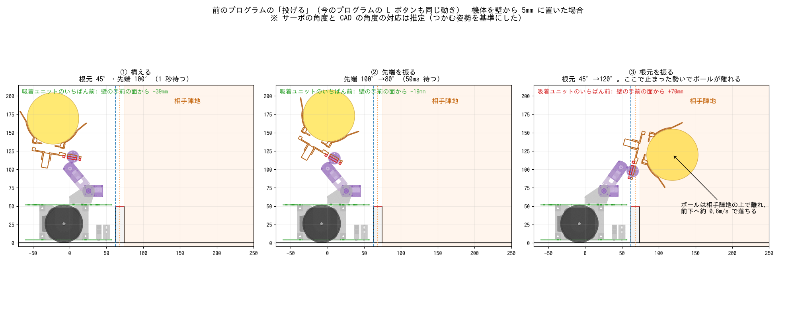

# 投げる仕組みの検討（Issue #11）

検討日: 2026-11-13

## 結論

- **今の L ボタンの「投げる」（前のプログラムと同じ動き）で十分**。実機で壁を越えて相手陣地に入った。
- **中央の壁から 1 マス手前の区画から投げても入った**。
- 大会に確認した内容は「アームは壁の上まで出してよい」。1 マス手前から投げれば、アームは壁の上にも相手陣地の上にも出ないので、規程 1-5 の心配がない。
- 自動で投げるときは、**中央の壁に面した区画の 1 つ手前の区画**から、中央の壁に向いて投げる。

## 今の投げ方

上の図は、機体を壁から 5mm の所に置いた場合を CAD で再現したもの。サーボの角度と CAD の角度の対応は、つかむ姿勢を基準にした推定。

| 順番 | 動き | `config.h` |
| --- | --- | --- |
| ① 構える | 根元を 45°、先端を 100° にして 1 秒待つ。腕を後ろへ大きく上げ、ボールを上に載せた姿勢になる | `ARM_THROW_READY_*` |
| ② 先端を振る | 先端を 80° へ（すばやく）。50ms 待つ | `ARM_THROW_UPPER`、`ARM_THROW_UPPER_WAIT_MS` |
| ③ 根元を振る | 根元を 120° へ（すばやく）。腕が前へ約 75° 回り、止まった勢いでボールが離れて飛ぶ | `ARM_THROW_LOWER`、`ARM_THROW_TIME` |

- 投げている間も、吸引ファンは回ったまま。
- 壁のすぐ前で投げると、③ で吸着ユニットが壁の手前の面から約 70mm 先（相手陣地の上）まで出る。**壁のすぐ前では投げない**。

## 投げる場所

- 中央の壁に面した区画の 1 つ手前の区画で、中央の壁に真っすぐ向いて止まり、投げる。
- 1 マス手前でも入ることは実機で確かめた。2 マス以上手前からも入るかは、まだ試していない。
- 壁を越えて相手陣地に入れば、落ちる場所はどこでもよい（チームの方針）。
- 相手陣地に落ちたあとでボールが外へ出ても負けにはならない（規程 4-12）。ただし、自分の陣地から直接外へ出すと負けになるので、外周の壁に向けては投げない。

## 次にやること

1. 地図から、投げる区画を選ぶ（中央の壁に面した区画の 1 つ手前で、その間に壁がない所）。
2. 投げる区画まで移動して中央の壁に向き、`arm_throw()` を呼ぶ流れを作る（Issue #11 の残り）。

## 計算との違い（メモ）

最初は「アームを壁の手前の面より前に出さない」という条件で計算し、今のアームでは速さが足りない見込みとしていた。サーボの速さには、他サイトの値（0.19 秒 / 60°、5V・無負荷）を使った。

しかし実機では、1 マス手前からでも入った。計算の前提のどれかが実物と違う（たとえば、サーボが実際はもっと速い、ボールが離れる瞬間が違う）。**投げる強さは、計算ではなく実機の結果で決める**。
