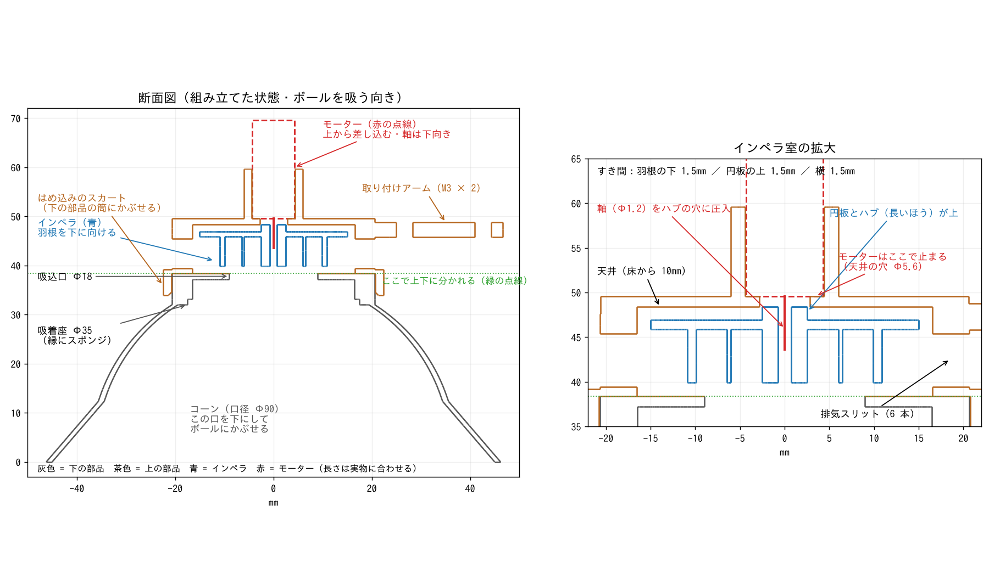
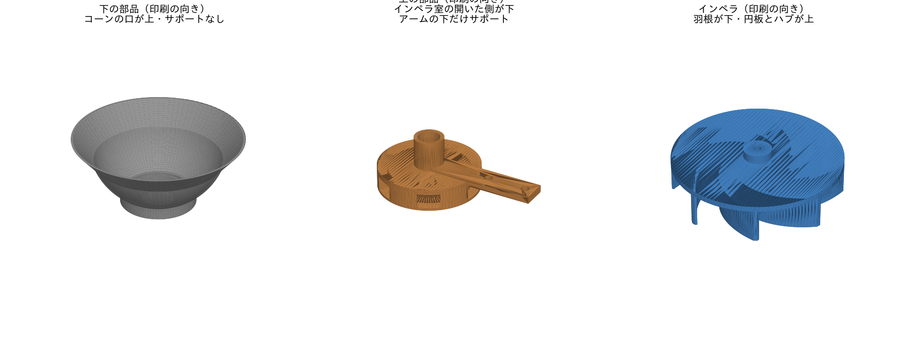
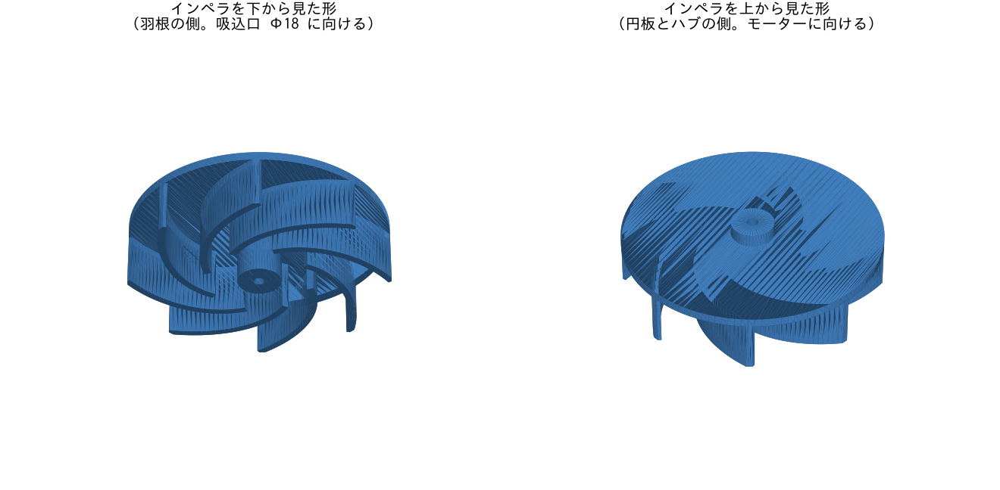
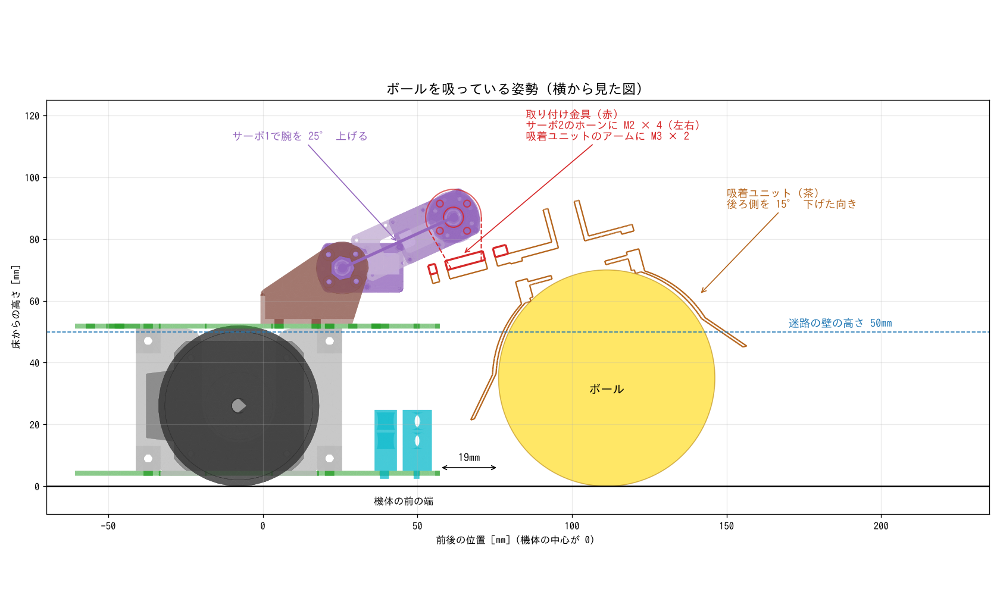
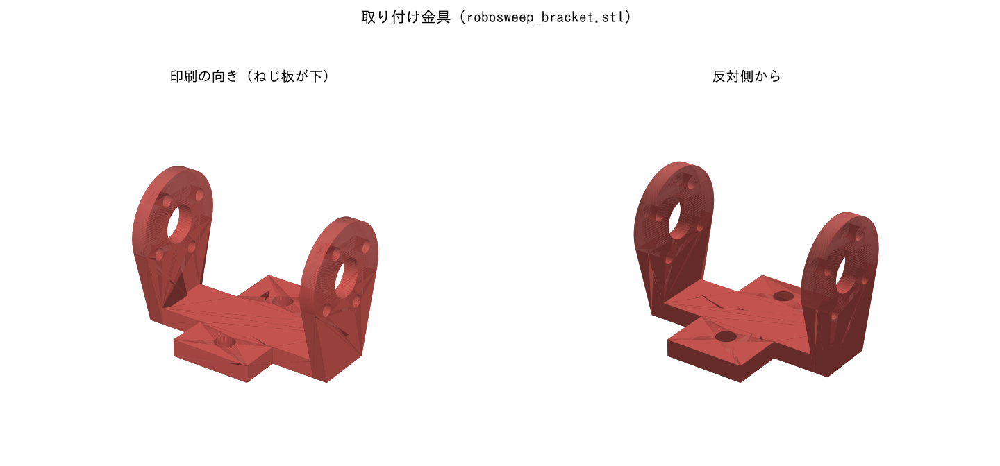

# ボール吸着ユニット

アームの先端に付けて、ボールを上から吸い付けるユニットです。チームの引き継ぎメモをもとにまとめています。

## 方針

- ステッパーマウスに 2 軸アームを付け、その先端にこの吸着ユニットを付けます。
- 遠くから吸い寄せるのではなく、**上からコーンをかぶせ、コーンの形でボールを中心に寄せてから吸い付けます**。
- 必要な静圧は、座面 Φ35 で約 200Pa です。マウス用ファン（約 830Pa の見積もり）なら、3〜4 倍の余裕があります。

## 仕様

外形 約 Φ92 × 60mm、重さ 約 30g（ボール込みで約 50g）。吸着ユニットの軸は STL の (x, y) = (0, 0) です（取り付けアームがあるので、外形の中心とは 0.21mm ずれています）。

| 部分 | 仕様 |
| --- | --- |
| コーン | 口径 Φ90（ボールの位置が約 ±25〜30mm ずれても吸える）。内面は、吸い付いたボールから 1mm 離れる曲面 |
| 吸着座 | Φ35。縁にスポンジを貼ってすき間をふさぐ |
| 吸込口 | Φ18 |
| インペラ室 | 内径 Φ33、**高さ 10mm**（元は 8mm）。側面に排気スリット 6 本 |
| モーター | NFP-D8620-3665-3-7.4（Φ8.6、軸 Φ1.2）。内径 Φ8.8 のボスに上から差し込む。**インペラ室の天井（穴 Φ5.6）で止まる**。軸は下向き |
| インペラ | Φ30、後ろ向きの羽根 8 枚（厚さ 0.8mm、出口角 35°、高さ 6mm）、円板 1mm、全体の高さ 8.5mm。モーター側から見て時計回り用。軸穴 Φ1.5（ハブ外径 5mm） |
| すき間 | インペラとインペラ室: 下 1.5mm / 上 1.5mm / 横 1.5mm。ハブの上端とモーター: 1.2mm |
| 取り付け | アーム（M3 × 2 本、間隔 16mm、軸から 26.6mm と 42.6mm） |

## ファイル

| ファイル | 内容 | 大きさ |
| --- | --- | --- |
| `robosweep_effector_lower.stl` | **下の部品**：コーン + 吸着座 + 吸込口 Φ18 の板 | 92.4 × 92.4 × 38.4mm |
| `robosweep_effector_upper_fit-0.1.stl` | **上の部品（はめ込み）【これを使う】**：インペラ室（スリット付き）+ 天井 + モーターのボス + 取り付けアーム + はめ込みのスカート（高さ 6mm）。スカートの内径 Φ41.14（下の部品の筒 Φ41.24 より 0.1mm 小さい、しまりばめ）。P2S の試験リングで、これがちょうどよかった | 68.8 × 44.3 × 27.2mm |
| `robosweep_effector_upper_fit+0.1.stl` / `_fit0.0.stl` / `_fit-0.2.stl` | 上の部品（はめ込み）の、内径 Φ41.34 / 41.24 / 41.04。印刷機を変えたとき用（P2S ではすき間 +0.2〜+0.5mm はどれもゆるかった） | 同上 |
| `fit_test_skirt.stl` | はめ込みの試験リング 4 つ（切り欠きの数 1 / 2 / 3 / 4 個 = すき間 +0.1 / 0 / −0.1 / −0.2mm）。印刷機を変えたときに選び直す | 95 × 95 × 7.0mm |
| `robosweep_effector_upper.stl` | 上の部品（スカートなし）。テープで止める場合 | 67.3 × 41.3 × 21.2mm |
| `robosweep_bracket.stl` | **取り付け金具**：サーボ2の両側のホーンに M2 × 4（左右。板の厚さ 1.6mm、中央の穴 Φ8）、吸着ユニットのアームに M3 × 2。ねじ板を下にして印刷（サポートなし） | 32.3 × 24.5 × 25.0mm |
| `robosweep_impeller_d1.5.stl` | **インペラ（軸穴 Φ1.5）【これを使う】**。P2S の試し刷りで、モーターの軸（Φ1.2）がちょうどよく入った | Φ30 × 8.5mm |
| `robosweep_impeller_d1.3.stl` / `_d1.4.stl` / `_d1.2.stl` | インペラ（軸穴 Φ1.3 / Φ1.4 / 元の Φ1.2）。P2S ではきつかった。印刷機を変えたとき用 | Φ30 × 8.5mm |
| `fit_test_p2s.stl` | はめあいの試験片（軸穴 1.0〜1.4mm、モーター穴 8.6〜8.9mm） | 98 × 16 × 9.5mm |
| `robosweep_effector_assembled.stl` | 上下を組み立てた形（確認用。**このままでは印刷できない**） | 約 92.8 × 92.4 × 59.6mm |
| `robosweep_effector_original.stl` / `robosweep_impeller_original.stl` | 受け取ったままの元の形（直す前）。スクリプトはここから作り直す | — |
| `robosweep_bracket_pose.stl` | 取り付け金具を、ボールを吸う姿勢で機体の座標に置いたもの（確認用） | — |
| `tools/fix_parts.py` | インペラ室（高さ・天井の止め）とインペラ（ハブ・軸穴）を直すスクリプト | — |
| `tools/split_effector.py` | 組み立てた形を上下に分けるスクリプト | — |
| `tools/add_press_fit.py` | 上の部品にはめ込みのスカートを付け、試験リングを作るスクリプト | — |
| `tools/make_bracket.py` | 取り付け金具を作るスクリプト（寸法は機体全体の STEP「全体 v11」から） | — |
| `tools/render_images.py` | `images/` の画像（section / parts / impeller）を作るスクリプト | — |

作り直すときは、`hardware/suction-effector` で次の順に実行します（`pip install trimesh manifold3d numpy shapely matplotlib`）。

```bash
python tools/fix_parts.py
python tools/split_effector.py robosweep_effector_assembled.stl .
python tools/add_press_fit.py
python tools/make_bracket.py
python tools/render_images.py
```







### 元の STL から変えたこと

- 組み立てた形のままだとインペラ室が閉じていて、印刷したあとにインペラを入れられない。そのため、吸込口の板の上面（インペラ室の床、z = 38.4mm）で上下に分けた。
- 元の STL では、取り付けアームの下面がインペラ室の中に 0.6mm はみ出していて、インペラ室の高さが 7.4mm（インペラは 7.0mm）しかなかった。インペラ室の中をまるごと空け、さらに**天井を 2mm 上げて高さを 10mm** にした。
- 元の STL では、モーターの穴が天井を突き抜けていて、モーターが止まらなかった。**天井の穴を Φ5.6 にして、モーターが天井の上面で止まる**ようにした。インペラのハブ（Φ5）はこの穴に入る。
- インペラは、円板の上に出ているハブを 1mm 短くした（高さ 9.5mm → 8.5mm）。軸穴は Φ1.5 に広げた（Φ1.2 のままだと、印刷で細くなって軸が入らない）。
- 寸法を変えて作り直すための `effector.py` / `impeller.py` は、まだリポジトリに入っていない。

## 機体への取り付け





吸着ユニットは、**取り付け金具**（`robosweep_bracket.stl`）でアームの先（サーボ2）に付けます。

- 金具はコの字形です。サーボ2の両側のホーン（RH01 とフリーホーン）を左右から挟んで、それぞれ M2 × 4 本で留めます（ホーンのねじ穴は半径 6.22mm の円周上）。フリーホーンは、穴が金具の穴に合う向きに回してから留めます。
- 吸着ユニットのアーム（M3 × 2、間隔 16mm）を、金具の下の細い板に下から当てて、M3 で留めます。
- ボールを吸うときは、**吸着ユニットの後ろ側（機体側）が 15° 下がった向き**になります。機体が前に進むと、コーンの後ろの縁がボールを前に押して、吸着座に寄せます。

ボールを吸っている姿勢（機体全体の STEP「全体 v11」で確かめたもの）

| 項目 | 値 |
| --- | --- |
| サーボ1で腕を上げる角度 | 約 25°（今の CAD の水平の位置から） |
| サーボ2の軸 → アームの上面 | 16mm |
| ボールの中心 | 機体の前の端（基板の端）から約 19mm 前 |
| 吸着ユニットの後ろの縁 | 床から約 22mm（センサーホルダーより前） |

- この姿勢で、金具・吸着ユニット・モーターが機体（サーボ1・2、サーボ連結部品、基板、センサーホルダーなど）にぶつからないことを確かめています。
- 金具の右の板とサーボ2の本体の間は 1mm です。これはホーンの厚さで決まるすき間です。板はホーンと一緒に本体の横を平行に回るので、当たりません。
- **ほかの姿勢（腕やサーボ2を動かしている途中）では確かめていません。** 動かす範囲を決めたら確認してください。

## 組み立て方

```
          ┌──┐   ← モーター（上から差し込む。軸は下向き）
          │  │      ボス（内径 Φ8.8）
     ═════╧══╧═════  ← 天井（穴 Φ5.6）。モーターはここで止まる
     ║  インペラ  ║  ← インペラ室（内径 Φ33、高さ 10mm）。側面のスリットから排気
     ═════════  ═════  ← ここで上下に分かれる（上の部品のスカートが下の部品の筒にかぶさる）
     ════╗ Φ18 ╔════   ← 下の部品：吸込口の板
        ╱  吸着座 Φ35  ╲
       ╱     コーン      ╲
```

1. 上の部品のボスに、上からモーターを差し込む（強く押し込まない）。**天井に当たって止まるところまで**入れて、接着する。軸がインペラ室に出る。
2. インペラ室の開いた側から、インペラを軸に圧入する。**円板と長いハブの側をモーター側（上）、羽根の開いた側を下**に向ける。
3. インペラを押し込む深さで、高さを合わせる。**羽根の下端が、インペラ室の開いた側の面（下の部品の板が当たる面）から 1.5mm 引っ込む**くらいがちょうど真ん中。指で軸を回して、どこにも擦れないことを確かめる。
4. 下の部品を、上の部品のスカートに**はめ込む**。スカートが下の部品の筒（Φ41.24、吸込口の板の下）にかぶさり、インペラ室の壁の下端が板の上面に当たったところで止まる。
   - P2S では、スカートの内径を筒より 0.1mm 小さくした `robosweep_effector_upper_fit-0.1.stl` がちょうどよかった（すき間 +0.2〜+0.5mm はどれもゆるかった）。スカートの高さは 6mm（筒のまっすぐな部分 6.4mm のほとんど）。印刷機を変えたときは `fit_test_skirt.stl` で選び直す。
   - ゆるくて空気が漏れるときは、継ぎ目にテープを巻くか、接着する。継ぎ目から空気が漏れると、吸う力が弱くなる。
   - スカートなしの上の部品を使うときは、継ぎ目にテープを 1 周巻いて位置を合わせ、空気が漏れないようにふさぐ。
5. 上から見て、インペラが**時計回り**に回ることを確かめる。逆ならモーターの配線を入れ替える。

## 印刷の条件

Bambu Lab P2S、0.4mm ノズル、PLA

- 小さい穴は 0.1〜0.2mm 細く印刷される前提で寸法を決めています。P2S は機体ごとに差があるという報告があるので、**必ず試し刷りしてください**。
- インペラの軸穴は、**Φ1.5 の STL（`robosweep_impeller_d1.5.stl`）を使います**。P2S の試し刷りで、モーターの軸（Φ1.2）がちょうどよく入りました。ゆるいときは接着します。
- インペラは、羽根の先を下にして（STL の向きのまま）印刷します。円板は羽根の上にブリッジで印刷されます。
- コアレスモーターのケースはつぶれやすいので、強く押し込まないでください。
- インペラの周速は約 45 m/s です。**バランス取りが必須です**（振動が IMU に乗らないように）。
- **下の部品**は、コーンの口を上にして置きます（STL がその向きになっています）。サポートは要りません。外側のコーンの一部が 45〜55° の張り出しになるので、表面が少し荒れることがあります。
- **上の部品（はめ込み）**は、スカートを下にして置きます（STL がその向きになっています）。
  - 天井（Φ33、中央に Φ5.6 の穴）と、側面のスリットの上は、ブリッジで印刷します。
  - **サポートは 2 か所に付けます**。Bambu Studio の「サポートのペイント」で、この 2 か所だけ塗ると楽です。どちらも、インペラ室の開いた側から取り外せます。
    - 取り付けアームの下（壁から約 25mm 突き出している）
    - スカートの内側にある、インペラ室の壁の下端の輪（台から 6.0mm の高さ、幅 約 4mm）。ここは下の部品の板に当たって止まる面なので、サポートの跡はやすりで平らにする
- **上の部品（スカートなし）**は、インペラ室の開いた側を下にして置きます。サポートは取り付けアームの下だけです。
- **試験リング**は、つばを下にして置きます。サポートは要りません。
- **取り付け金具**は、ねじ板を下にして置きます（STL がその向きになっています）。サポートは要りません。

## 次にやること

1. ~~試験リングで、はめ込みのすき間を決める~~ → 決まった（スカートの内径 Φ41.14、インペラの軸穴 Φ1.5）
2. 実物のボールで吸い付きを確かめる（ボールの表面から空気が漏れないか、どれだけずれても吸えるか）
3. 取り付け金具を印刷して、サーボ2に付け、ボールを吸う姿勢を確かめる
4. 壁越しにボールを投げる方法を決める（壁越しに投げてよいことは大会に確認済み。[ルールまとめ](../../docs/rules/robosweep-rules.md) の A2）
